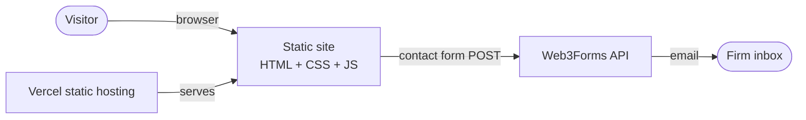
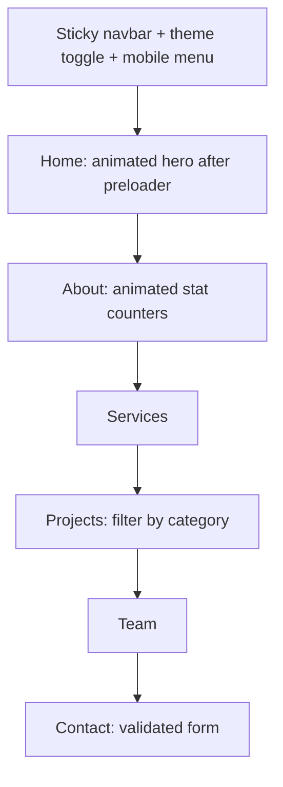

# Linark: High-Level Design

A portfolio website for an architecture firm (Linaark Architects), with smooth animations, a light / dark theme, filterable projects and a working contact form. Live at [linark.vercel.app](https://linark.vercel.app). For code-level detail see the [Low-Level Design](lld.md).

## 1. System context

The site is pure HTML, CSS and vanilla JavaScript with no build step and no framework. The only external service is Web3Forms, which turns form submissions into emails.

## 2. Page sections

## 3. Features

| Feature | How |
|---|---|
| Light / dark theme | Toggle stored in `localStorage` (default dark) |
| Custom cursor | Follower that grows on links and buttons (desktop) |
| Scroll reveal | `IntersectionObserver` fades sections and cards in |
| Stat counters | Count up over 2 seconds when visible |
| Project filter | All / Residential / Commercial / Concept |
| Contact form | Field validation, toast messages, sends via Web3Forms |
| Parallax and magnetic buttons | Scroll and mouse-move effects |
| Responsive | Hamburger menu and fluid layouts for mobile |

## 4. Tech stack

| Layer | Choice |
|---|---|
| Markup | Semantic HTML5 (`index.html`) |
| Styling | Plain CSS with variables for theming (`styles.css`) |
| Behavior | Vanilla JavaScript (`script.js`), no libraries |
| Forms | Web3Forms |
| Hosting | Vercel |

## 5. Quality attributes

| Attribute | Approach |
|---|---|
| Speed | No framework or bundle; one HTML, one CSS and one JS file |
| Maintainability | Each feature is one `init…()` function, all started on `DOMContentLoaded` |
| Accessibility of content | Real HTML sections and links that work without JavaScript |
| Known limits | Content is hard-coded in HTML; the form depends on Web3Forms being available |
