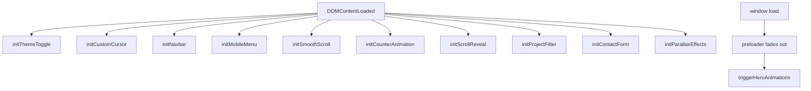
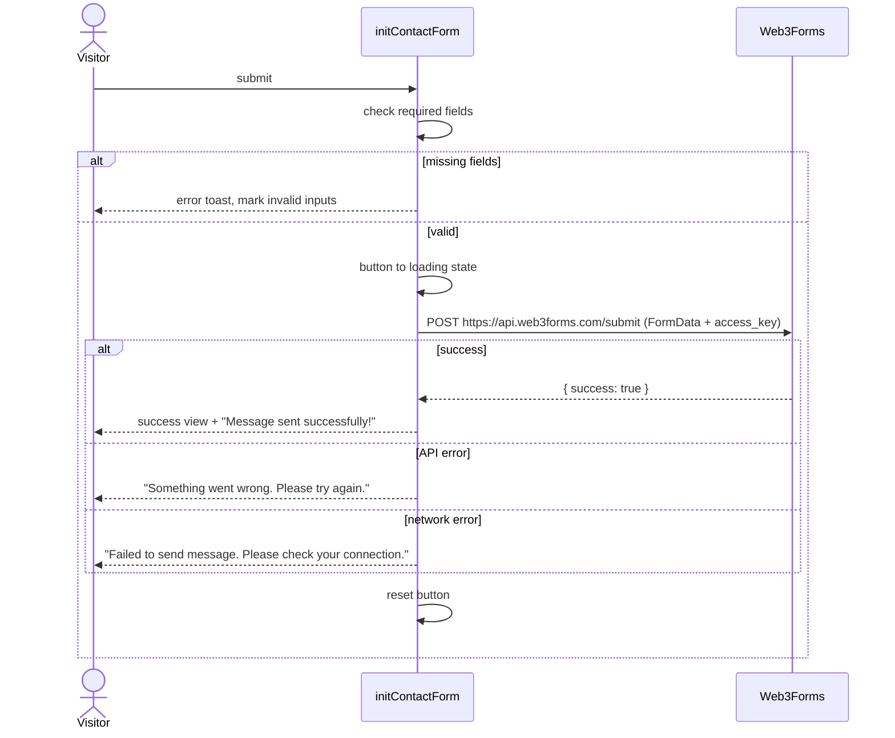

# Linark: Low-Level Design

Script modules, the contact-form flow and the project filter. For the big picture see the [High-Level Design](hld.md).

## 1. Files

| File | Lines | Role |
|---|---|---|
| `index.html` | ~670 | Sections: `home`, `about`, `services`, `projects`, `team`, `contact` |
| `styles.css` | ~3100 | Theme variables, layout, animations, responsive rules |
| `script.js` | ~780 | All behavior, split into `init…()` functions |
| `images/` | | Project images (concept, interior, tower, urban, villa) |

## 2. Script modules

| Function | Behavior |
|---|---|
| `initThemeToggle` | Reads `localStorage.theme` (default `dark`), sets the theme attribute, saves on toggle |
| `initCustomCursor` | Cursor dot + follower animated with `requestAnimationFrame`; enlarges on interactive elements |
| `initNavbar` | Adds a scrolled style and highlights the active section while scrolling |
| `initMobileMenu` | Hamburger opens / closes the menu; closes after choosing a link |
| `initSmoothScroll` | Smooth-scrolls anchor links with an offset for the fixed navbar |
| `initCounterAnimation` | When the stats enter view, counts each up to its `data-target` over 2000 ms (~16 ms steps), once |
| `initScrollReveal` | Two `IntersectionObserver`s reveal sections and cards |
| `initProjectFilter` | Shows cards whose `data-category` matches the active `data-filter` |
| `initContactForm` | Validates, submits to Web3Forms, shows toasts and a success state with "send again" |
| `initParallaxEffects` | Scroll parallax and magnetic hover on buttons |
| `triggerHeroAnimations` | Runs after the preloader fades (or immediately if there is none) |
| `typeWriter(el, text, speed = 50)` | Typing-effect helper; defined but not currently used |

## 3. Contact form

Inputs are re-checked on `input` and `blur` so error styles clear as the visitor fixes them.

## 4. Project filter

| Button `data-filter` | Shows cards with `data-category` |
|---|---|
| `all` | every card |
| `residential` | `residential` |
| `commercial` | `commercial` |
| `concept` | `concept` |

The active button gets the `active` class; non-matching cards are hidden with a fade.

## 5. Configuration

The Web3Forms `access_key` is set in `script.js`. Web3Forms keys are designed to be public (they only allow sending to the registered inbox). Change it to send messages to a different inbox.
